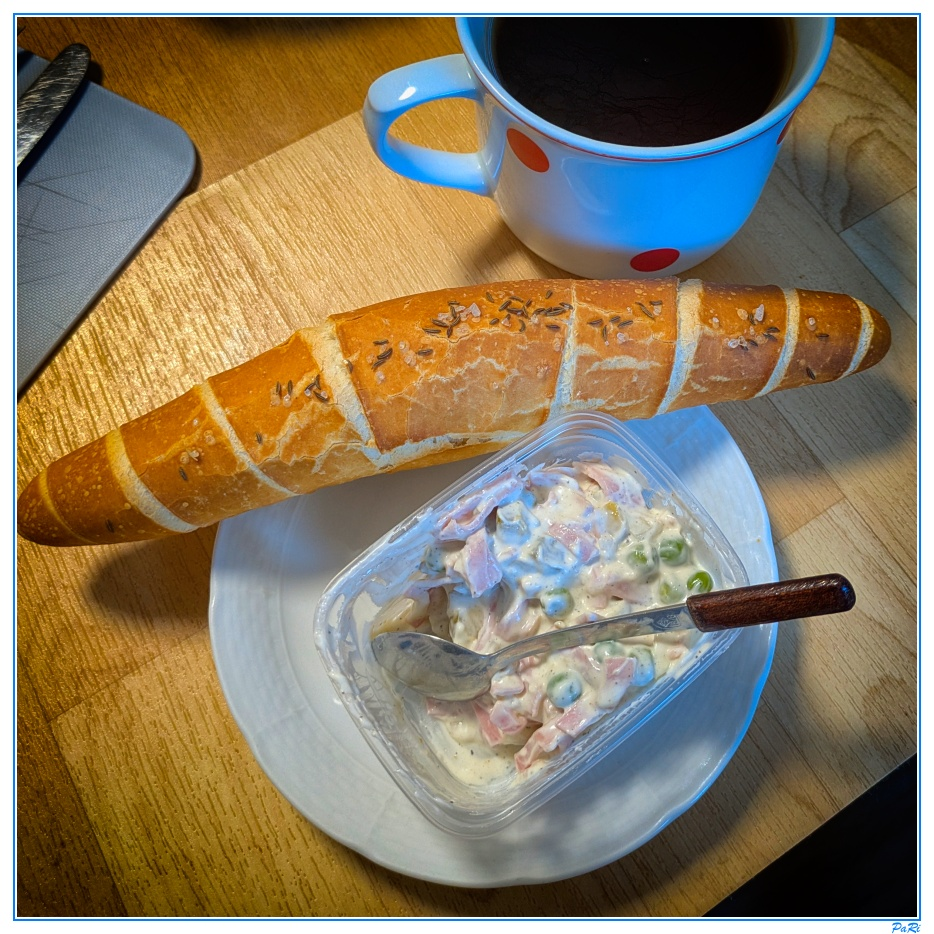

# PhotoFramer

**English** | [Česky](#česky)




*Example of a finished photo: square crop, resized to 900 px, white strip, thin blue line and signature.*

A small desktop app (WPF, .NET 10) for quick editing of documentary photos: square crop, resize, optional editing in an external application (Nik Collection – Analog Efex Pro 2), a frame made of a strip and coloured lines, and a signature.

## What it does

1. **Square crop**, done by hand right in the main window.
2. **Resize** to the target size (default 900×900 px, Mitchell resampling).
3. **Editing in an external application** (optional): Analog Efex Pro 2 is launched, you pick a recipe and click Save. If you close it without saving, the step is cancelled.
4. **Frame**: a strip of configurable width and colour plus any number of lines, each with its own distance, thickness and colour. Updates live.
5. **Signature** in the bottom-right corner of the strip (font, size, style, colour, offsets).
6. **Save** as JPG (quality 1–100 %) or PNG (compression 0–9), optionally also to the clipboard.

## Requirements

- Windows 10/11 x64
- [.NET 10 SDK](https://dotnet.microsoft.com/download) to build (the self-contained EXE needs nothing else)
- For the external editing step: Nik Collection (Google, 2016) in `C:\Program Files\Google\Nik Collection\`

## Build and run

```bash
dotnet build PhotoFramer.slnx
dotnet test PhotoFramer.slnx
dotnet run --project src/PhotoFramer.App
```

### Single EXE

```bash
publish.cmd          # self-contained EXE (~70 MB, includes .NET)
publish.cmd small    # small EXE (~10 MB), requires the .NET 10 Desktop Runtime
```

The result is `publish\PhotoFramer.exe`. The script can also copy the EXE to a folder configured at the top of `publish.cmd`, if that folder exists.

## Usage

1. **File → Open** (Ctrl+O), drag a file into the window, **Paste from clipboard** (Ctrl+V), or pass a file path on the command line.
2. Adjust the crop rectangle and click **Crop** (Ctrl+Enter or double-click in the crop view).
3. Fine-tune the frame and signature (settings panel behind the ☰ button).
4. **Save** (Ctrl+S) saves using the profile settings, **Save as…** (Ctrl+Shift+S) opens a dialog, **Save to clipboard** (Ctrl+Shift+C) copies the image.
5. **Reload** (F5, Ctrl+R) restores the original file for a new crop.

### Crop keys

| Key | Action |
|---|---|
| arrow keys | move the crop by 1 px (Shift = 20 px) |
| numeric `+` / `−` | grow / shrink the crop by 1 px (Shift = 20 px) |
| mouse wheel | resize the crop |
| drag a corner / the inside | resize / move |

### Total Commander

Put the parameters in quotes, otherwise TC passes a short 8.3 name for file names with spaces:

```
Command:    c:\wapp\PhotoFramer\PhotoFramer.exe
Parameters: "%p%n"
```

If "Close the window after saving a file from the command line" is enabled, the app closes after saving.

## Configuration

- `%APPDATA%\PhotoFramer\settings.json` – profiles and application settings (including window position)
- `%APPDATA%\PhotoFramer\photoframer.log` – log

Everything is edited in the app. **Profiles** (e.g. "Document", "Web") hold the target size, output format and quality, output folder, name suffix, frame and signature. An empty output folder means next to the original; the original file is never overwritten.

## Structure

```
PhotoFramer.slnx
├─ src/PhotoFramer.Core     core: ImagePipeline, FrameRenderer, NikRunner, SettingsService, ImageIO
├─ src/PhotoFramer.App      WPF app (MVVM, CommunityToolkit.Mvvm, Fluent theme)
├─ tests/PhotoFramer.Tests  xUnit tests
└─ tools/IconGenerator      generator of the application icon
```

Libraries: [SkiaSharp](https://github.com/mono/SkiaSharp) (drawing, resampling, JPEG/PNG), [CommunityToolkit.Mvvm](https://github.com/CommunityToolkit/dotnet), WPF codecs for TIFF.

### Analog Efex Pro 2 integration

The app launches `Analog Efex Pro 2.exe` (the 64-bit one preferably) with the path of a temporary 8-bit TIFF as the argument. After you click Save the plugin overwrites the file and exits. If the file did not change, the step is treated as cancelled. The path is set in the settings panel and is pre-filled automatically. `NikRunner` makes it easy to add another Nik Collection plugin.

## Limitations

- One photo at a time; there is no file queue.
- EXIF orientation and ICC profiles are not handled.
- Dark mode uses the built-in WPF Fluent theme (still experimental in .NET 10).

---

# Česky

[English](#photoframer) | **Česky**


*Ukázka hotové fotografie: čtvercový ořez, zmenšení na 900 px, bílý pruh, tenká modrá linka a podpis.*

Malá desktopová aplikace (WPF, .NET 10) pro rychlou úpravu dokumentárních fotografií: čtvercový ořez, zmenšení, volitelná úprava v externí aplikaci (Nik Collection – Analog Efex Pro 2), orámování pruhem a barevnými čarami a podpis.

## Co aplikace dělá

1. **Ořez na čtverec** ručně přímo v hlavním okně.
2. **Zmenšení** na cílovou velikost (výchozí 900×900 px, resampling Mitchell).
3. **Úprava v externí aplikaci** (volitelně): spustí se Analog Efex Pro 2, vyberete recept a kliknete na Save. Když okno zavřete bez uložení, krok se zruší.
4. **Rámeček**: pruh nastavitelné šířky a barvy a libovolný počet čar s vlastní vzdáleností, tloušťkou a barvou. Mění se živě.
5. **Podpis** v pravém dolním rohu pruhu (font, velikost, řez, barva, odsazení).
6. **Uložení** jako JPG (kvalita 1–100 %) nebo PNG (komprese 0–9), případně i do schránky.

## Požadavky

- Windows 10/11 x64
- [.NET 10 SDK](https://dotnet.microsoft.com/download) pro build (pro spuštění hotového soběstačného EXE nic dalšího netřeba)
- Pro úpravu v externí aplikaci: Nik Collection (Google, 2016) v `C:\Program Files\Google\Nik Collection\`

## Build a spuštění

```bash
dotnet build PhotoFramer.slnx
dotnet test PhotoFramer.slnx
dotnet run --project src/PhotoFramer.App
```

### Jeden EXE

```bash
publish.cmd          # soběstačný EXE (~70 MB, obsahuje .NET)
publish.cmd small    # malý EXE (~10 MB), vyžaduje .NET 10 Desktop Runtime
```

Výsledek je `publish\PhotoFramer.exe`. Skript umí EXE zkopírovat i do složky nastavené na začátku `publish.cmd`, pokud existuje.

## Použití

1. **Soubor → Otevřít** (Ctrl+O), přetažení souboru do okna, **Vložit ze schránky** (Ctrl+V), nebo cesta k souboru jako parametr příkazové řádky.
2. Upravte výřez a klikněte na **Ořez** (Ctrl+Enter nebo dvojklik v okně ořezu).
3. Doladte rámeček a podpis (panel nastavení pod tlačítkem ☰).
4. **Uložit** (Ctrl+S) uloží podle profilu, **Uložit jako…** (Ctrl+Shift+S) otevře dialog, **Uložit do schránky** (Ctrl+Shift+C) zkopíruje obrázek.
5. **Znovu načíst** (F5, Ctrl+R) vrátí původní soubor k novému ořezu.

### Klávesy při ořezu

| Klávesa | Akce |
|---|---|
| šipky | posun výřezu o 1 px (Shift = 20 px) |
| numerické `+` / `−` | zvětšení / zmenšení výřezu o 1 px (Shift = 20 px) |
| kolečko myši | změna velikosti výřezu |
| tažení za roh / uvnitř | změna velikosti / posun |

### Total Commander

V příkazu uživatele nastavte parametry v uvozovkách, jinak TC předá u názvů s mezerami zkrácený název 8.3:

```
Příkaz:    c:\wapp\PhotoFramer\PhotoFramer.exe
Parametry: "%p%n"
```

Pokud je zapnuto „Zavřít okno po uložení souboru z příkazové řádky“, aplikace se po uložení zavře.

## Konfigurace

- `%APPDATA%\PhotoFramer\settings.json` – profily a nastavení aplikace (včetně polohy okna)
- `%APPDATA%\PhotoFramer\photoframer.log` – log

Nastavení se edituje v aplikaci. **Profily** (např. „Dokument“, „Web“) obsahují cílovou velikost, výstupní formát a kvalitu, výstupní složku, příponu názvu, rámeček a podpis. Výstupní složka prázdná znamená vedle originálu, původní soubor se nikdy nepřepíše.

## Struktura

```
PhotoFramer.slnx
├─ src/PhotoFramer.Core     jádro: ImagePipeline, FrameRenderer, NikRunner, SettingsService, ImageIO
├─ src/PhotoFramer.App      WPF aplikace (MVVM, CommunityToolkit.Mvvm, Fluent téma)
├─ tests/PhotoFramer.Tests  xUnit testy
└─ tools/IconGenerator      generátor ikony aplikace
```

Použité knihovny: [SkiaSharp](https://github.com/mono/SkiaSharp) (kreslení, resampling, JPEG/PNG), [CommunityToolkit.Mvvm](https://github.com/CommunityToolkit/dotnet), WPF kodeky pro TIFF.

### Integrace s Analog Efex Pro 2

Aplikace spustí `Analog Efex Pro 2.exe` (přednostně 64bitový) s cestou k dočasnému 8bitovému TIFFu jako parametrem. Plugin po kliknutí na Save přepíše soubor a ukončí se. Pokud se soubor nezměnil, krok se považuje za zrušený. Cesta k aplikaci se nastavuje v panelu nastavení a je předvyplněna automaticky. `NikRunner` umožňuje snadno přidat i jiný plugin z Nik Collection.

## Omezení

- Zpracovává se vždy jedna fotka, fronta souborů se nepoužívá.
- EXIF orientace a ICC profily se neřeší.
- Tmavý režim používá vestavěné Fluent téma WPF (v .NET 10 stále experimentální).
